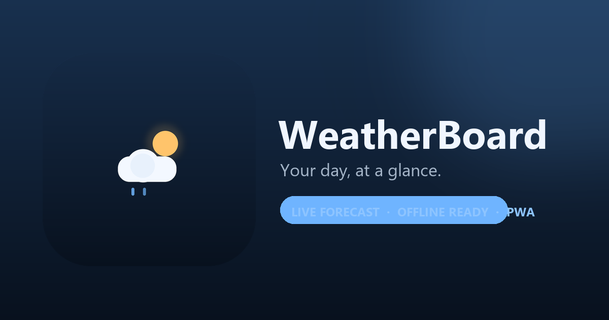

# WeatherBoard

A calm, installable personal weather dashboard built with React, Vite, and real public APIs.
Search for any city, read current conditions and a five-day forecast, save up to five favourite
cities, install it as a PWA, and keep the last viewed city available offline.

> **Live app:** _Add your deployment URL here (for example `https://weatherboard.vercel.app`)._
>
> **Public repository:** _Add your GitHub repository URL here._



---

## Overview

WeatherBoard is a single-page React application with no backend. It is designed around one job:
show the weather clearly, without noise. The interface uses a restrained navy/blue palette, an
optional light theme, self-hosted Inter typography, Lucide icons, and small purposeful motion.

- **Primary weather:** OpenWeatherMap (when `VITE_OPENWEATHER_API_KEY` is configured)
- **Weather fallback:** Open-Meteo (live, no key required)
- **Primary city search:** GeoDB Cities via RapidAPI (when `VITE_GEODB_RAPIDAPI_KEY` is configured)
- **Search fallback:** Open-Meteo Geocoding (live, no key required)
- **First-run city:** Karachi, Pakistan; afterwards the last viewed city is restored

Provider names are shown in the UI. Mock weather is never presented as live data.

---

## Features

### Mandatory challenge features

1. **City search with autocomplete**
   - 300 ms debounce, request cancellation, in-memory result cache, duplicate-request prevention.
   - City name, region, and country shown for each suggestion.
   - Keyboard navigation with ArrowUp/ArrowDown, Enter, and Escape; click-outside dismissal.
   - Visible loading, empty, rate-limit, network, and provider-fallback states.
   - Validated on blur and submit with inline, accessible error messages.

2. **Real current weather and five-day forecast**
   - Temperature, feels-like temperature, humidity, wind speed, condition, and icon.
   - Local city time and date, including timezone-aware forecast labels.
   - Provider fallback with an explicit label and reason.
   - Loading skeletons, error states, retry action, and last-saved weather fallback.
   - Handles invalid keys, rate limits, timeouts, server errors, missing fields, and offline mode.

3. **Favourites**
   - Up to five cities, duplicate prevention, quick switching, and removal confirmation.
   - Persists across reloads in `localStorage`.
   - Gracefully degrades to an in-memory list when storage is blocked or unavailable.
   - Stored records are sanitised on read and capped at five entries.

4. **PWA**
   - Valid web manifest with 192×192, 512×512, and maskable 512×512 icons, standalone display,
     theme/background colours, and an app scope.
   - Service worker precaches the app shell, hashed JS/CSS, fonts, icons, and manifest.
   - Navigation network-first with cached shell fallback; static assets stale-while-revalidate;
     API GETs network-first with cache fallback.
   - Offline banner, cached-data indicator, and an honest "no saved weather" state.
   - In-app update banner when a new service worker is waiting.

5. **Daily reminder**
   - Explains why permission is needed before the browser prompt appears.
   - Time picker, enable/disable, test notification, and next-reminder display.
   - Handles `granted`, `denied`, `default`, unsupported, and page-only notification support.
   - In-app scheduler with a 90-minute catch-up window and one notification per day.
   - Optional Chromium Periodic Background Sync registration where available.
   - Clearly documents the client-only delivery limitation (see
     [Daily reminder implementation](#daily-reminder-implementation)).

6. **Responsive design**
   - Verified at 375 px, 768 px, and 1280 px with no horizontal overflow.
   - Mobile forecast becomes a two-column grid with the fifth day full-width.
   - Tablet sidebar becomes two columns; desktop uses a main/sidebar layout.
   - 44×44 px minimum touch targets on mobile and tablet widths.

7. **Accessibility and UX**
   - Semantic landmarks, labelled controls, visible focus rings, skip link, and live regions.
   - Accessible validation errors linked with `aria-describedby`; `aria-invalid` on failure.
   - Meaningful loading, empty, error, and offline copy.
   - Reduced-motion support via `prefers-reduced-motion`.
   - Lighthouse accessibility, best-practices, and SEO scores of 100 on the production build.

### Optional enhancements

- Dark/light theme with system-preference default, pre-paint theme restoration, and persistence.
- Celsius/Fahrenheit toggle with persisted preference.
- Subtle floating weather icon animation and card hover transitions.
- Self-hosted Inter variable font so typography also works offline.
- Install button appears only when the browser fires `beforeinstallprompt`.

---

## Tech stack

| Area | Choice |
| --- | --- |
| UI | React 19, JSX, HTML5, CSS3 |
| Build | Vite 7 |
| Icons | Lucide React |
| Font | `@fontsource-variable/inter` |
| State | React hooks and small focused custom hooks |
| Storage | `localStorage` with in-memory fallback |
| APIs | OpenWeatherMap, Open-Meteo, GeoDB Cities (RapidAPI) |
| PWA | Web App Manifest, service worker, Cache API, Notifications API |
| Tests | Vitest |
| Lint | ESLint 10 |
| Deployment | Vercel or Netlify (static SPA) |

No TypeScript, UI kit, backend, database, or paid service is used.

---

## Folder structure

```text
My_WeatherBoard/
├─ .github/workflows/ci.yml      # lint, test, build on every push/PR
├─ public/
│  ├─ icons/                     # 192, 512, maskable, Apple, badge icons
│  ├─ favicon.svg
│  ├─ favicon-32.png
│  ├─ manifest.webmanifest
│  ├─ og-image.png
│  ├─ robots.txt
│  └─ service-worker.js
├─ src/
│  ├─ components/
│  │  ├─ CityClock.jsx
│  │  ├─ ConfirmDialog.jsx
│  │  ├─ ErrorState.jsx
│  │  ├─ FavoritesPanel.jsx
│  │  ├─ Forecast.jsx
│  │  ├─ ForecastDay.jsx
│  │  ├─ Header.jsx
│  │  ├─ LoadingState.jsx
│  │  ├─ OfflineBanner.jsx
│  │  ├─ ReminderPanel.jsx
│  │  ├─ SearchBar.jsx
│  │  ├─ StatusPill.jsx
│  │  ├─ Toast.jsx
│  │  ├─ UpdateBanner.jsx
│  │  ├─ UpdatedAt.jsx
│  │  ├─ WeatherCard.jsx
│  │  ├─ WeatherDetails.jsx
│  │  └─ WeatherIcon.jsx
│  ├─ hooks/
│  │  ├─ useCitySearch.js
│  │  ├─ useFavorites.js
│  │  ├─ useInstallPrompt.js
│  │  ├─ useOnlineStatus.js
│  │  ├─ usePreferences.js
│  │  ├─ useReminderSettings.js
│  │  ├─ useServiceWorker.js
│  │  └─ useWeather.js
│  ├─ services/
│  │  ├─ geoDbService.js
│  │  ├─ http.js
│  │  ├─ notificationService.js
│  │  ├─ openMeteoService.js
│  │  ├─ searchService.js
│  │  └─ weatherService.js
│  ├─ utils/
│  │  ├─ city.js
│  │  ├─ config.js
│  │  ├─ dateHelpers.js
│  │  ├─ favorites.js
│  │  ├─ reminderHelpers.js
│  │  ├─ storage.js
│  │  ├─ validation.js
│  │  ├─ weatherCache.js
│  │  ├─ weatherHelpers.js
│  │  └─ *.test.js
│  ├─ styles/index.css
│  ├─ App.jsx
│  └─ main.jsx
├─ .env.example
├─ .gitignore
├─ .nvmrc
├─ eslint.config.js
├─ index.html
├─ netlify.toml
├─ package.json
├─ vercel.json
├─ vite.config.js
├─ vitest.config.js
├─ README.md
└─ PROMPTS.md
```

---

## Installation

**Prerequisites:** Node.js 20.19+ or 22+ and npm. The project was built and tested on Node 22.15
with npm 10.9.

```bash
npm install --legacy-peer-deps
```

`--legacy-peer-deps` is used because the ESLint/Vite React plugin peer ranges are stricter than the
versions pinned for this project. The production build does not depend on that flag.

### Run locally

```bash
npm run dev
```

Open the URL printed by Vite, usually `http://localhost:5173`. The app works immediately with
Open-Meteo even when no API keys are present.

### Build for production

```bash
npm run build
npm run preview
```

The production output is written to `dist/`. `npm run preview` serves it locally, which is the best
way to test the service worker and offline cache.

### Quality commands

```bash
npm run lint
npm test
```

---

## Environment variable setup

Copy the example file and fill in the keys you have:

```bash
cp .env.example .env
```

| Variable | Required | Purpose | Where to get it |
| --- | --- | --- | --- |
| `VITE_OPENWEATHER_API_KEY` | Optional | Primary current weather + five-day forecast | [OpenWeatherMap API keys](https://home.openweathermap.org/api_keys) |
| `VITE_GEODB_RAPIDAPI_KEY` | Optional | Primary city autocomplete | [GeoDB Cities on RapidAPI](https://rapidapi.com/wirefreethought/api/geodb-cities) |
| `VITE_GEODB_RAPIDAPI_HOST` | Optional | RapidAPI host, defaults to `wft-geo-db.p.rapidapi.com` | GeoDB dashboard |

Without keys, the app runs with live Open-Meteo weather and geocoding. With keys, OpenWeatherMap
and GeoDB are tried first and the active provider is labelled under each result and the weather
card.

**Vite client variables are public.** Any variable prefixed with `VITE_` is embedded in the
JavaScript bundle and is readable by anyone using the app. Never put a private server secret,
payment key, or privileged token in a `VITE_` variable. For this client-only challenge, use
restricted/free-tier browser keys, monitor their usage, and rotate them if abused. A production app
that needs to protect a paid key should proxy requests through a server instead.

`.env` and `.env.*.local` are ignored by Git; `.env.example` is committed.

---

## API setup instructions

### OpenWeatherMap

1. Create a free account at <https://home.openweathermap.org/users/sign_up>.
2. Open **API keys** and copy the default key.
3. Put it in `.env` as `VITE_OPENWEATHER_API_KEY=...`.
4. New keys can take a short time to activate. If the key is rejected, the UI reports an invalid-key
   state and open-meteo fallback remains available.

Endpoints used:

- `GET https://api.openweathermap.org/data/2.5/weather?lat=&lon=&appid=&units=metric`
- `GET https://api.openweathermap.org/data/2.5/forecast?lat=&lon=&appid=&units=metric`

The five-day endpoint returns three-hourly entries. They are grouped by the city's local date,
min/max values are aggregated, and the condition closest to local noon is used for the day icon.

### GeoDB Cities via RapidAPI

1. Create/sign in to a RapidAPI account.
2. Subscribe to the free **GeoDB Cities** plan at
   <https://rapidapi.com/wirefreethought/api/geodb-cities>.
3. Copy the `X-RapidAPI-Key` value into `VITE_GEODB_RAPIDAPI_KEY`.
4. Keep `VITE_GEODB_RAPIDAPI_HOST=wft-geo-db.p.rapidapi.com`.

Request used:

```text
GET https://wft-geo-db.p.rapidapi.com/v1/geo/cities
    ?namePrefix=<query>&limit=8&sort=-population&types=CITY
Headers: X-RapidAPI-Key, X-RapidAPI-Host
```

### Open-Meteo (no key)

- Weather: `https://api.open-meteo.com/v1/forecast`
- Geocoding: `https://geocoding-api.open-meteo.com/v1/search`

Open-Meteo is free for non-commercial use and needs no key. Search results are ordered by
population where the API supplies it. The provider is labelled in the UI whenever it is used.

---

## Architecture decisions

- **Services own API calls.** Components and hooks never build provider URLs directly.
  `weatherService` and `searchService` decide which provider to call and normalise the result shape.
- **Provider-neutral data model.** Both weather providers are mapped to Celsius and km/h before
  they reach the UI, so unit conversion and fallback cannot mix incompatible values.
- **Hook-per-concern.** Search, weather, favourites, preferences, online status, reminders, install
  prompt, and service-worker updates each have a focused hook. `App.jsx` composes them.
- **Race-safe async work.** Search and weather requests use `AbortController`, request IDs, and
  cleanup on unmount, so stale responses cannot overwrite newer state.
- **Storage wrapper.** `storage.js` catches blocked/full localStorage, keeps an in-memory copy, and
  reports write failures. Favourites and preferences continue to work for the session even when
  persistence is unavailable.
- **Manual service worker.** The worker is intentionally hand-written (rather than generated) so the
  caching strategies, update flow, reminder metadata, and offline fallback are explicit and
  auditable.
- **No router.** WeatherBoard is a single dashboard; a router would add weight without a product
  need.
- **Self-hosted font.** Inter is bundled through Fontsource, so the app does not depend on a
  third-party font CDN at runtime or offline.
- **Design system in CSS variables.** Colours, surfaces, borders, radii, shadows, and transitions are
  tokens; light theme and responsive rules reuse them.
- **Timezone-aware dates.** Forecast days and the city clock use the city's IANA timezone when
  available, falling back to the provider's UTC offset or the browser clock. This is why a city's
  "Today" can differ from the visitor's local date near midnight.

---

## API integration details

### Request handling

- `fetchJson` wraps `fetch` with a 10-second weather timeout, a 9-second search timeout, JSON
  parsing, abort forwarding, and error codes:
  `invalid_key`, `not_found`, `rate_limit`, `server`, `request`, `timeout`, `network`,
  `missing_data`.
- Aborts caused by newer searches or unmounts are ignored rather than shown as errors.
- API failures never blank the whole dashboard: cached weather and the rest of the UI remain usable.

### Search behaviour

- Queries shorter than two characters do not hit the network.
- Input is debounced by 300 ms; previous requests are aborted; duplicate queries are served from a
  30-entry in-memory cache.
- GeoDB is tried first when configured. If it returns no results or fails, Open-Meteo geocoding is
  used and a visible warning explains the source.
- Selecting a result stores its city identity (name, region, country, coordinates, timezone,
  provider ID) and loads weather for those coordinates.

### Weather fallback order

1. If an OpenWeatherMap key exists, request current conditions and forecast in parallel.
2. On timeout, invalid key, rate limit, network/server failure, or unusable payload, request
   Open-Meteo.
3. Mark the result with `fallback: true` and the primary failure reason.
4. If both live providers fail and a matching last-weather cache exists, show it as
   `CACHED`/`Showing saved weather` with the failure detail.

The forecast is always limited to five days in the UI, even though Open-Meteo can return seven.

---

## PWA and offline implementation

### Manifest

`public/manifest.webmanifest` declares the name, short name, description, `id`, `start_url`, scope,
`standalone` display, theme/background colours, language, categories, and icons:

- `icons/icon-192.png` — 192×192, `purpose: any`
- `icons/icon-512.png` — 512×512, `purpose: any`
- `icons/icon-maskable-512.png` — 512×512, `purpose: maskable`
- Apple touch icon and notification badge are also included.

### Service worker

`public/service-worker.js` is registered by `useServiceWorker`. It uses four caches:

| Cache | Contents |
| --- | --- |
| `weatherboard-shell-v1` | `/`, `index.html`, manifest, icons, hashed JS/CSS |
| `weatherboard-runtime-v1` | Fonts and other same-origin static assets |
| `weatherboard-api-v1` | Successful weather/geocoding GET responses (limited to 50) |
| `weatherboard-meta-v1` | Reminder metadata shared with the worker |

Strategies:

- **Navigations:** network-first. Successful HTML is cached. On a network error or a 5xx response,
  the cached request, `index.html`, or `/` is returned so the app still opens.
- **Static assets:** stale-while-revalidate, with a bounded runtime cache.
- **API GETs:** network-first, with the cached response used only when the network fails.
- **Updates:** a changed worker enters `waiting`; `UpdateBanner` offers a refresh that posts
  `SKIP_WAITING`, then reloads. Old `weatherboard-*` caches are removed on activation.

### Last weather and offline behaviour

- After every successful live response, the last city and normalised weather are saved to
  `localStorage` (`weatherboard:last-weather:v1`). Only the most recent city is stored.
- If the browser goes offline, the banner reads
  "You're offline. Showing the last saved weather for {city}."
- If saved weather matches the selected city, the card shows a **CACHED** pill, the saved timestamp,
  and an explanation that live conditions are unavailable.
- If no saved weather exists for that city, the card shows an actionable offline error instead of
  inventing data.
- Service-worker API caching provides a second layer for recent successful requests.

---

## Daily reminder implementation

The reminder is implemented with the Notifications API and the registered service worker:

1. The panel explains what will be sent and why before requesting permission.
2. Permission is requested only after the user presses **Allow notifications**.
3. Once granted, the chosen time (default `07:00`) is stored locally and shared with the service
   worker through the Cache API.
4. While the app is open, a once-a-minute check asks `getReminderSchedule` whether the reminder is
   due. A 90-minute catch-up window means a reminder still appears if the tab was backgrounded near
   the chosen time. It fires at most once per local day.
5. If available, Chromium's **Periodic Background Sync** is registered with a 12-hour minimum
   interval. The service worker can then show the notification during a browser-scheduled sync.
6. **Send test** proves that notifications work without waiting for the schedule.
7. Notification clicks focus an existing window or open the app.

### Honest limitation: closed-browser delivery

A client-only app cannot guarantee a notification at an arbitrary time after the browser is fully
closed. The in-app timer only runs while the page lives; Periodic Background Sync is
Chromium-specific, best-effort, requires installation/engagement, and is scheduled by the browser,
not by the app. It is not a reliable alarm.

True guaranteed Web Push requires:

- a backend with VAPID keys,
- a push subscription stored server-side,
- a cron/scheduled job that sends the push at the chosen time,
- and the push service to deliver it even when the browser is closed.

That backend is outside the challenge's client-only scope. WeatherBoard therefore implements the
best feasible local solution and states the limitation plainly in the UI and this README. It does
not claim guaranteed background delivery.

Notifications also require a secure context: `https://` or `localhost`.

---

## Responsive design and accessibility

### Responsive breakpoints

| Width | Layout |
| --- | --- |
| ≥ 1025 px | Main weather/forecast column + sidebar; compact desktop controls |
| ≤ 1024 px | Single dashboard column; sidebar becomes two columns; 44 px controls |
| ≤ 900 px | Header stacks brand/actions above a full-width search field |
| ≤ 720 px | Sidebar becomes one column |
| ≤ 640 px | Mobile spacing, 2-column forecast with a full-width fifth day, 44 px targets |
| ≤ 400 px | Tighter padding, two-column weather stats, smaller brand |

The install button is hidden below 640 px to keep the header uncluttered. Installation remains
available from the browser menu. No horizontal overflow was measured at 375, 768, or 1280 px.

### Accessibility measures

- Skip link to `#main-content`.
- `<header>`, `<main>`, `<aside>`, `<section>`, `<footer>`, headings, and labelled form controls.
- Search combobox pattern with `aria-expanded`, `aria-controls`, `aria-activedescendant`,
  `aria-autocomplete`, and `aria-selected` options.
- Live status regions for search results, toasts, banners, and reminder messages.
- Inline errors use `role="alert"`, `aria-invalid`, and `aria-describedby`.
- `:focus-visible` outlines; reduced-motion media query; 4.5:1+ text contrast in both themes.
- Icon-only buttons have descriptive accessible names; decorative icons are hidden from assistive
  technology.
- Accessible names include visible label text (brand and °C/°F controls), verified with Lighthouse.

---

## Testing and quality assurance

### Automated tests

```text
npm test
```

Result at hand-off: **31 tests passed across 5 files**.

Coverage includes:

- PWA manifest completeness, on-disk icon dimensions, `index.html` manifest/theme links, and
  service-worker lifecycle/precache hooks.
- Open-Meteo geocoding normalisation, population ordering, empty responses, and invalid payloads.
- WMO and OpenWeatherMap condition mapping, including day/night icons.
- OpenWeatherMap three-hourly forecast aggregation: grouping, min/max, nearest-noon condition,
  past-entry filtering, invalid rows, five-day cap.
- Open-Meteo current/daily normalisation, missing-data errors, and provider labels.
- Celsius/Fahrenheit conversion and temperature/wind formatting.
- Reminder time parsing, due/later-today/missed-window/already-sent/invalid states.
- City timezone date keys with IANA zones and UTC-offset fallback.
- City creation, key stability, subtitle formatting, coordinate validation, sanitisation.
- Favourite de-duplication, invalid rows, and five-item cap.
- Search, reminder, and API error message mapping.

### Manual browser QA performed

| Area | Checks performed | Result |
| --- | --- | --- |
| Live weather | Open-Meteo current conditions and 5-day forecast for Karachi, London, Paris | Pass |
| Search | Debounce (rapid typing produced exactly one request), loading, results, no-results, provider label | Pass |
| Keyboard | ArrowDown/ArrowUp, Enter selection, Escape close, focus retention | Pass |
| Validation | Blur with 1 character, empty submit, inline `aria-invalid` and error copy | Pass |
| Favourites | Add, duplicate, limit, persist after reload, remove cancel/confirm, empty state | Pass |
| Preferences | Theme and °C/°F toggles persist; theme applied before paint | Pass |
| Offline | Cached shell opened with server stopped; cached weather labelled; offline banner; no fake live data | Pass |
| PWA | Manifest, icons, SW registration, shell/runtime caches, service worker control | Pass |
| Responsive | 375/768/1280 layouts, overflow, touch targets, forecast and sidebar reflow | Pass |
| Lighthouse | Production preview: Accessibility 100, Best Practices 100, SEO 100, zero failed audits after the accessible-name fix | Pass |

### Known testing gaps

- No OpenWeatherMap or GeoDB credentials were available, so their happy paths could not be
  exercised against live responses. The fallback paths were tested live, and the primary mappers
  and error handling are unit-tested.
- Notification permission was already **denied** in the automated browser environment, so the
  permission-prompt-to-granted flow could not be completed there. The denied/blocked fallback was
  verified, and the granted path is implemented with the standard Notifications API and service
  worker `showNotification`.
- The service worker update banner was exercised by changing the worker; a real second deployment
  should be used to re-verify in staging.

### Lint and build

```text
npm run lint   # passes
npm run build  # passes; ~312 kB JS / ~36.5 kB CSS before gzip
```

The build output is a static `dist/` folder. No server runtime is required.

---

## Security and configuration

- API keys come from `VITE_*` environment variables; no keys are committed.
- `.env`, `.env.local`, and `.env.*.local` are git-ignored; `.env.example` documents required names.
- Vite inlines `VITE_*` values into the client bundle. They are **not secrets**. Use free/restricted
  keys and document their exposure, or proxy requests through a backend for privileged keys.
- No private server credentials, auth tokens, or backend secrets are present.
- All network requests use HTTPS in production; notifications require a secure context.
- User input is length-limited, trimmed, and validated before requests.
- Stored JSON is parsed defensively; corrupt values are removed, and favourite/city records are
  re-sanitised on read.
- `vercel.json` and `netlify.toml` set long-lived immutable caching for hashed assets and
  revalidation for `service-worker.js`.
- The app does not use `dangerouslySetInnerHTML`, `eval`, or untrusted HTML injection.

---

## Deployment instructions

### 1. Put the project on GitHub

```bash
git init -b main
git add .
git commit -m "Build WeatherBoard PWA"
git remote add origin https://github.com/<your-username>/weatherboard.git
git push -u origin main
```

Make the repository **public**. Confirm that `node_modules/`, `dist/`, and `.env` are not committed.

### 2. Deploy to Vercel

1. Import the GitHub repository at <https://vercel.com/new>.
2. Framework preset: **Vite**. Build command: `npm run build`. Output directory: `dist`.
3. Add `VITE_OPENWEATHER_API_KEY` and `VITE_GEODB_RAPIDAPI_KEY` under **Settings → Environment
   Variables** for Production, Preview, and Development as needed.
4. Deploy. `vercel.json` supplies service-worker and asset cache headers.
5. Open the HTTPS URL and verify the manifest, service worker, install prompt, and weather.

### 3. Deploy to Netlify (alternative)

1. Add the repository as a new site at <https://app.netlify.com/start>.
2. `netlify.toml` already sets `npm run build`, publish directory `dist`, Node 22, and cache headers.
3. Add the same environment variables under **Site configuration → Environment variables**.
4. Deploy and verify over HTTPS.

### 4. Post-deploy checks

- Open DevTools → Application → Manifest: no installability errors; both icon sizes present.
- Application → Service Workers: worker activated and controlling the page.
- Reload once, then stop the network or use offline mode: shell and last city should remain.
- Search, keyboard navigation, favourites, theme, and units in the deployed build.
- Notification permission flow on a real device; send a test notification.
- Run Lighthouse against the deployed URL.
- Replace the live URL and repository placeholders at the top of this README.
- Submit the live URL and public repository link to `jobs@edspire.app`.

---

## Known limitations

1. **No guaranteed closed-browser notifications.** A backend with Web Push/VAPID and scheduled
   sending would be required. In-app scheduling, the 90-minute catch-up window, and Chromium
   Periodic Background Sync are best-effort only.
2. **API keys are visible in the client bundle.** This is inherent to a client-only Vite app; use
   free-tier/restricted keys and monitor usage.
3. **Only one last-viewed city is cached for offline weather.** Opening a different, never-visited
   city while offline shows an actionable "no saved weather" state.
4. **City search requires a connection.** Search results are cached in memory for the session, not
   persisted for offline use.
5. **Free-tier API limits apply.** GeoDB and OpenWeatherMap can rate-limit; Open-Meteo fallback keeps
   weather available, and the UI explains provider fallbacks.
6. **PWA installation varies by browser.** The custom install button appears only when the browser
   fires `beforeinstallprompt`; iOS Safari uses its Share → Add to Home Screen flow.
7. **Notification support varies.** Some browsers support page notifications but not service-worker
   notifications; the app labels that page-only mode. Permission can be revoked at any time.
8. **Primary providers were not live-tested without keys.** The live fallback, normalisation, and
   error paths were tested.
9. **Timezone-aware day labels may differ from the visitor's date.** This is intentional: a city's
   forecast follows the city's local date, not the visitor's.
10. **No multi-tab synchronisation for reminder changes.** Favourites listen for the `storage` event;
    reminder settings do not broadcast across open tabs.

---

## Live URL placeholder

Replace this before submission:

```text
https://your-weatherboard.vercel.app
```

Repository placeholder:

```text
https://github.com/your-username/weatherboard
```

---

## Credits

- Weather data: [OpenWeatherMap](https://openweathermap.org/) and
  [Open-Meteo](https://open-meteo.com/)
- City data: [GeoDB Cities](https://rapidapi.com/wirefreethought/api/geodb-cities) via RapidAPI and
  [Open-Meteo Geocoding](https://open-meteo.com/en/docs/geocoding-api)
- Icons: [Lucide](https://lucide.dev/)
- Typography: [Inter](https://rsms.me/inter/) via Fontsource
- Challenge: Edspire Frontend (React) Developer Technical Challenge, November 2026

Built with React and Vite. Real data only, no mock weather in production.
